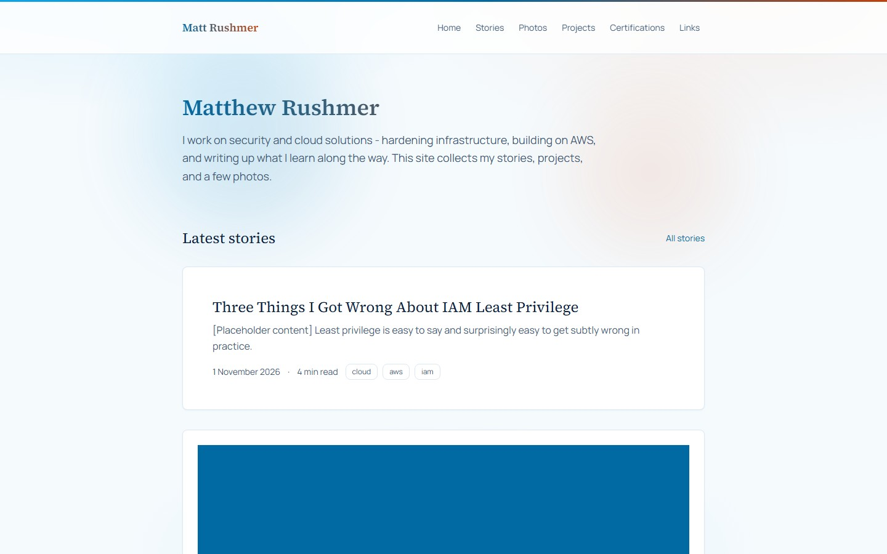
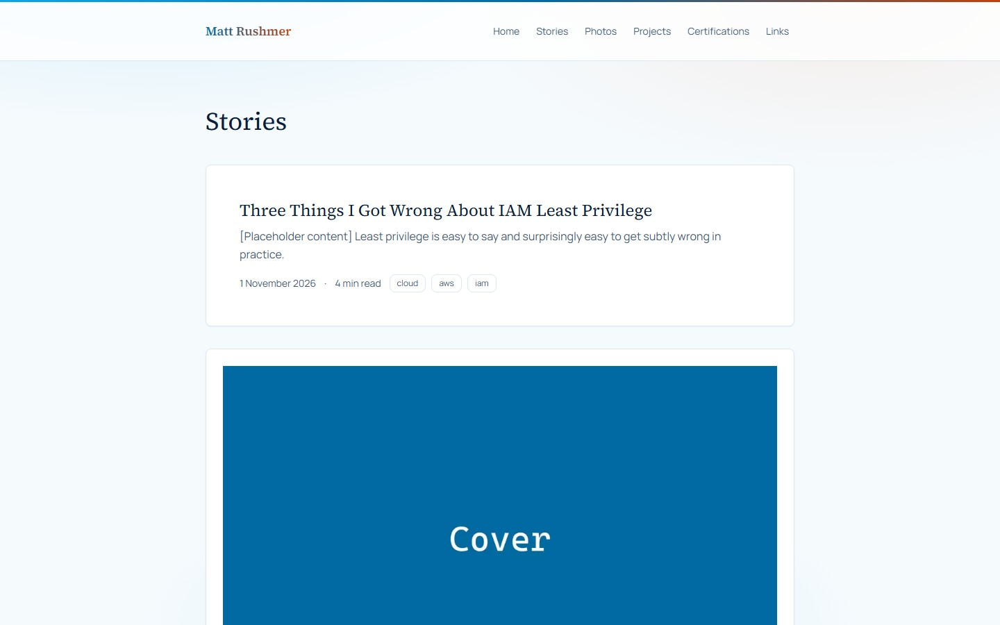
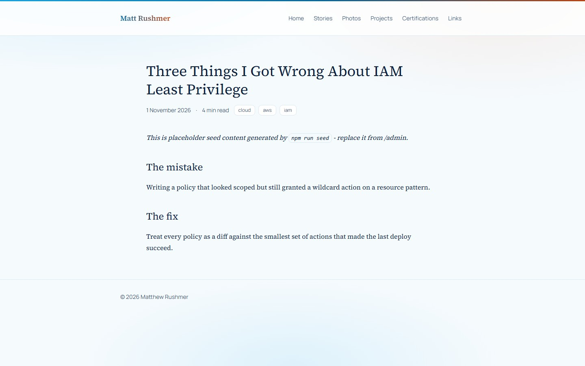
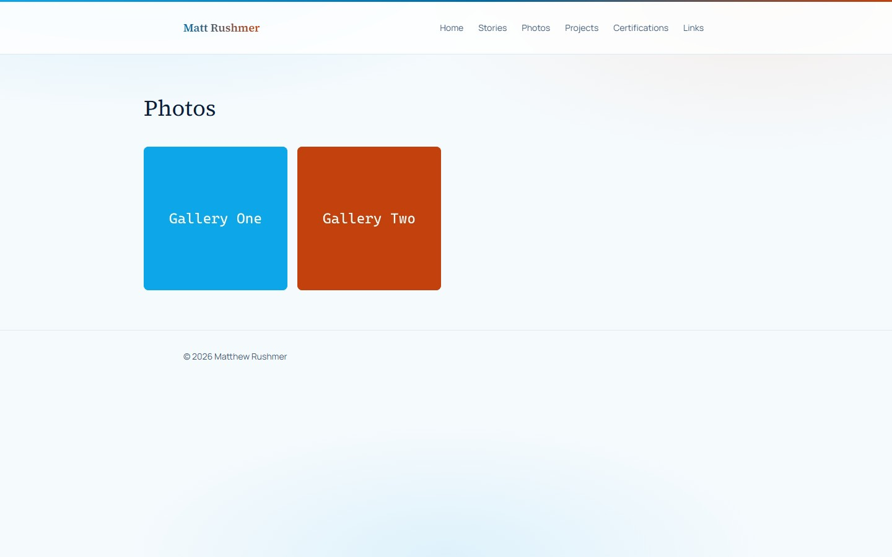
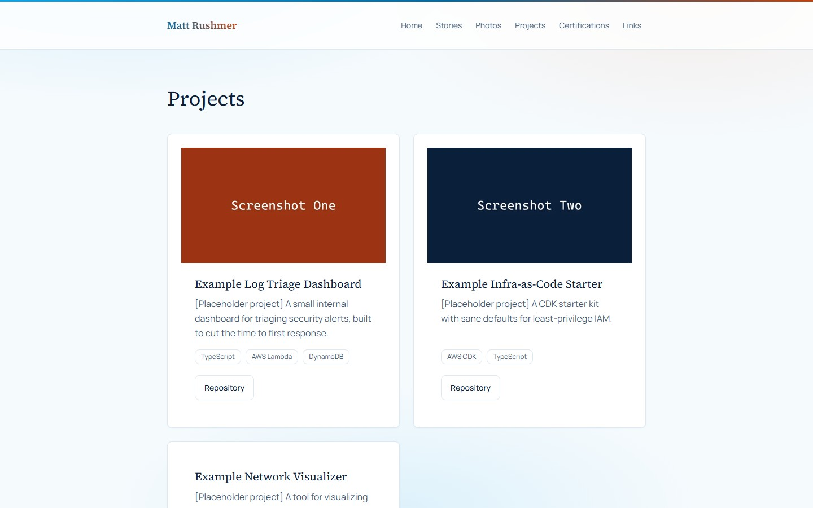
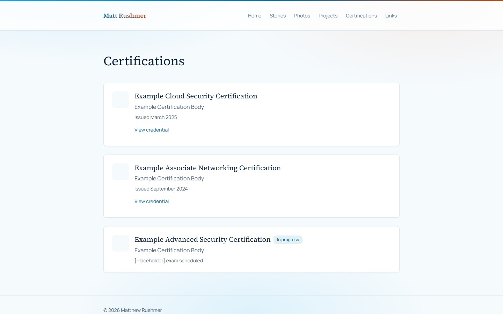
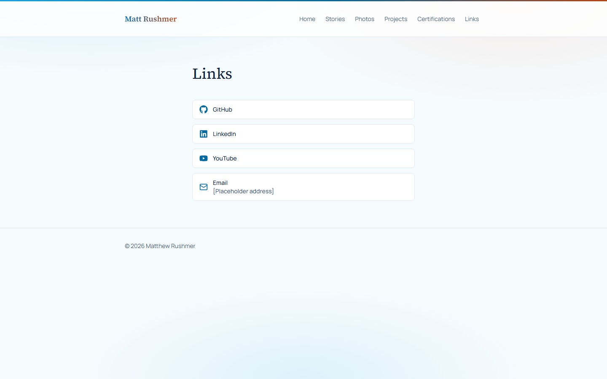
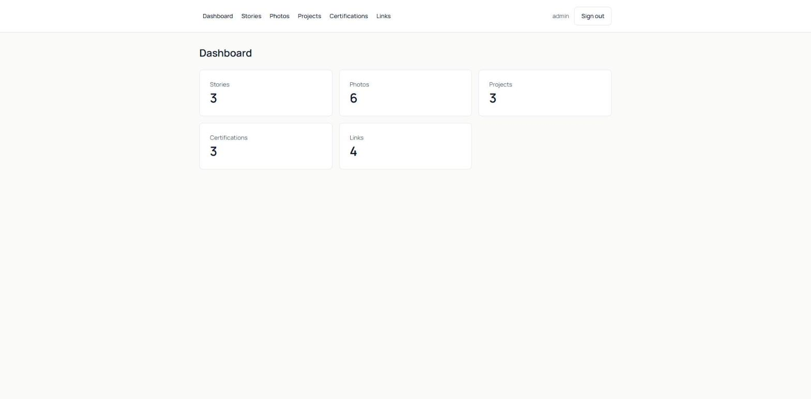
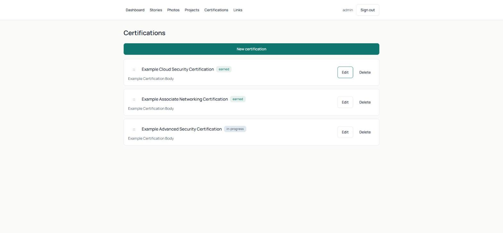

# Matt Rushmer | Security and Cloud Solutions

A personal blog and portfolio site for Matthew Rushmer. Built **local-first**: the
entire site — content, photos, admin login — runs on your own machine with
`npm install && npm run seed && npm run dev`, no AWS account, no cloud
credentials, no external services. The same codebase can later switch to a real
AWS deployment (DynamoDB, S3 + CloudFront, Cognito) by changing one environment
variable, because every environment-specific piece sits behind a small adapter
interface with exactly two implementations.

This README documents what the site does, how it's built, and — in full — the
process that built it: the order things were created in, which parts were
built by parallel coding agents, and every bug that independent review passes
found and fixed along the way.

---

## Screenshots

### Public site

| Home | Stories |
| --- | --- |
|  |  |

| Story detail | Photo gallery |
| --- | --- |
|  |  |

| Projects | Certifications |
| --- | --- |
|  |  |

| Links |
| --- |
|  |

All content shown is placeholder seed data generated by `npm run seed` —
replace it from `/admin` once you're running your own copy.

### Admin

| Dashboard | Content management (certifications shown; stories/projects/links/photos follow the same pattern) |
| --- | --- |
|  |  |

The admin area (`/admin`) lets the owner create and publish stories with a
Markdown editor and live preview, drag-and-drop upload photos, and manage
projects, certifications, and links — all without touching code.

---

## What this is

- **Home, Stories, Photos, Projects, Certifications, Links** — public pages,
  server-rendered, mobile-first, a sky blue / cloudy white palette with
  verified-accessible amber-red gradient accents, no dark-mode toggle
  (deliberately out of scope), WCAG AA contrast.
- **`/admin`** — single-owner login (local: username + password; AWS: Cognito
  with required MFA), Markdown story editor with live preview, drag-and-drop
  photo upload, and CRUD + drag-reorder for projects, certifications, and
  links, including a curated icon picker.
- **Local-first, AWS-ready** — the exact same application code runs against
  local JSON files and local disk today, and against DynamoDB, S3 +
  CloudFront, and Cognito once deployed, switched by one environment variable
  (`DEPLOY_TARGET=local|aws`). The AWS infrastructure is fully written as AWS
  CDK stacks and synthesizes cleanly, but **has not been deployed** — that's a
  deliberate, separate step (see [Future AWS deployment](#future-aws-deployment-not-yet-done)).

---

## Tech stack

| Layer | Choice |
| --- | --- |
| Framework | Next.js 15 (App Router), TypeScript (strict), Tailwind CSS v4 |
| Content (local) | JSON files under `./data`, atomic writes |
| Content (AWS) | DynamoDB, single table, one GSI |
| Photos (local) | `./data/uploads`, served by a route handler |
| Photos (AWS) | Private S3 bucket, CloudFront (OAC), presigned uploads |
| Image pipeline | `sharp` — in-process locally, S3-triggered Lambda in AWS, same rendition code in both |
| Admin auth (local) | bcrypt + signed httpOnly session cookie (`jose`) |
| Admin auth (AWS) | Cognito, single user, required TOTP MFA |
| Infrastructure | AWS CDK v2 (TypeScript), OpenNext for Next.js-on-Lambda |
| Tests | Vitest (unit + adapter contract tests), 52 passing |
| Markdown | `react-markdown` + `remark-gfm` + `rehype-sanitize` |
| Icons | `lucide-react` (generic) + `react-icons`/Font Awesome (brand marks) |

No ORMs, no CSS-in-JS, no UI component library, no state-management library —
Server Components for data, a handful of small Client Components for
interactivity (upload, drag-reorder, the Markdown editor, the lightbox).

---

## Architecture: the local-first adapter pattern

Every place the app would otherwise need to know "am I running locally or in
AWS?" is hidden behind one of exactly **four** adapter interfaces, each with
exactly two implementations:

```
src/adapters/
├── content-store/      ContentStore
│   ├── local/           → JSON files in ./data, atomic temp-file+rename writes
│   └── aws/              → DynamoDB single table (PK=TYPE#x, SK=ID#ulid) + GSI1
├── file-storage/        FileStorage
│   ├── local/            → ./data/uploads, served by a Next.js route handler
│   └── aws/               → Private S3 bucket, presigned PUT uploads
├── image-processing/    ImageProcessor
│   ├── local/             → sharp in-process on upload
│   └── aws/                → stub; real work happens in an S3-triggered Lambda
│                              sharing src/core/images/process.ts with local
└── auth/                 AuthAdapter
    ├── local/              → bcrypt + signed JWS session cookie
    └── aws/                 → Cognito USER_PASSWORD_AUTH + required MFA
```

`src/adapters/index.ts` exposes one memoized factory per adapter
(`getContentStore()`, `getFileStorage()`, `getImageProcessor()`,
`getAuthAdapter()`), each picking its implementation via `DEPLOY_TARGET` with
a dynamic `import()` — so the AWS SDK never ships in the local bundle, and
`sharp`/`node:fs` never ship in the AWS Lambda bundle.

**The adapters are tested against each other.** `tests/contract/` defines one
behavioral test suite per adapter and runs it twice: once against the real
local implementation, once against the real AWS implementation driven by a
minimal in-memory DynamoDB/S3 simulator (`aws-sdk-client-mock`). Same
assertions both times — this is what caught two real local/AWS divergence bugs
during development (see below).

Everything else — every public page, every admin route — calls
`getContentStore()`/`getFileStorage()` and has no idea which mode is active.

---

## Getting started

```bash
npm install
npm run seed     # generates .env.local with a random admin password (printed once),
                  # seeds placeholder stories/projects/certifications/links/photos
npm run dev       # → http://localhost:3000, admin at /admin
```

`npm run seed` is safe to re-run: it resets `./data` to a clean set of
placeholder content every time, but never overwrites an existing
`.env.local` — your admin password stays the same across reseeds. To change
it later:

```bash
npm run hash-password -- "your-new-password"
# paste the printed hash into ADMIN_PASSWORD_HASH in .env.local
```

### Production mode (still fully local)

```bash
npm run build
npm start         # → http://localhost:3000, same site, production build
```

### Tests

```bash
npm test               # unit + adapter contract tests (Vitest)
npm run test:coverage  # with coverage
```

### Linting and type-checking

```bash
npm run lint
npx tsc --noEmit
```

### Backing up your content

Everything the owner creates lives in `./data` (JSON files + `./data/uploads`,
both git-ignored). Back it up by copying that directory — there's no database
to export.

---

## Development process

This project was built end-to-end by Claude Code acting as lead engineer,
orchestrating itself and two external coding agents (Codex CLI, Cursor CLI)
across six phases, with git history kept as an explicit build log — every
commit is a Conventional Commit, every phase/feature happened on a
short-lived branch merged with `--no-ff`, so `git log --graph` reads as a
timeline of the actual work.

### Phase 1 — Plan

An `architect` subagent produced the full technical plan before any code was
written: the stack decision (confirming Next.js + CDK + DynamoDB + S3 +
Cognito, and specifically **OpenNext with a hand-written CDK stack rather
than SST** — SST v3 dropped CloudFormation entirely, which would break "CDK
for all infrastructure"), the DynamoDB single-table design, the exact
TypeScript signatures for all four adapter interfaces, the API route shape,
the folder structure, a text diagram of the future AWS architecture, and a
cost estimate (**≈$0.55–2.40/month** at personal-site traffic — see
[Future AWS deployment](#future-aws-deployment-not-yet-done)). This plan was
presented for approval before Phase 2 started.

### Phase 2 — Foundation

Built in small, independently-committed pieces, each one buildable and
tested before the next started:

1. Scaffold (Next.js 15 pinned deliberately — not 16 — to stay inside
   OpenNext's compatibility matrix), `.gitignore`.
2. `AGENTS.md` / `CLAUDE.md` / `.cursor/rules/project.md` — identical
   project-convention files so Claude Code, Codex, and Cursor never
   disagree about stack decisions, git workflow, or the do-not-touch list.
3. The config module (`src/config/`) — validates only the *active*
   `DEPLOY_TARGET` branch via zod, so the app never needs AWS values to run
   locally, and fails fast with a readable error if a required local var is
   missing.
4. Core entity types and zod schemas for all five content types.
5. All four adapters, local implementation first, then AWS, one adapter per
   commit/branch — content store, file storage, image processing, auth.
6. Vitest + the shared adapter contract test suite (the thing that later
   caught two real local/AWS divergence bugs).
7. Design tokens — a single light theme (plain hex values, not oklch,
   specifically so contrast ratios could be checked directly against
   WCAG's relative-luminance formula: accent `#0f766e` on white is 5.47:1,
   well past the 4.5:1 AA floor). This teal palette was later replaced in
   the [Phase 5 redesign](#phase-5--visual-redesign) — the plain-hex,
   verify-don't-eyeball approach it established stuck around.
8. The seed script — auto-generates a random admin password on first run
   (printed once, never a hardcoded default) and seeds realistic
   placeholder content, including **real photos run through the actual
   sharp rendition pipeline**, not fixture JSON with fake file references.
9. The CDK infrastructure stacks (`DataStack`, `AuthStack`, `SiteStack`,
   `OpsStack`) — written and `cdk synth`-clean from the start, never
   deployed.

### Phase 3 — Build (parallelized)

Once the adapters, design tokens, and a shared UI foundation
(`Button`/`Card`/`Tag`/`Badge`/`Icon`/`Picture`/Markdown renderer) existed,
two fresh subagents were launched **in parallel, each in its own isolated
git worktree**, with a long, specific brief each:

- **Agent A** built all six public pages, the site header/footer, the photo
  lightbox, and the sitemap/RSS/robots routes.
- **Agent B** built the entire admin surface: session API routes, CRUD API
  routes for all five entity types (with a shared route-handler factory so
  the auth check and the response envelope aren't copy-pasted five times),
  the two-step photo upload flow with magic-byte content validation, and
  every admin page and form.

Both agents found and reported real bugs in code neither of them was
assigned to touch (both branches were read-only against `src/adapters/**`
and `src/core/**`, so they couldn't fix these themselves):

- **Agent A found:** the local/AWS content-store adapter's draft-filtering
  logic checked *only* that an entity had a `status` field, not its value —
  since `Photo.status` (`uploading`/`processing`/`ready`/`failed`) happens
  to share a field name with `Story`/`Project`'s `draft`/`published` status,
  every photo was silently excluded from `list()` by default. Fixed with a
  regression test added to the adapter contract suite so it can't regress
  in either mode again.
- **Agent B found:** the seed script wrote the generated bcrypt hash
  unescaped into `.env.local` — Next.js expands unescaped `$NAME`
  references inside `.env*` files, so `$2b$12$...` was being silently
  mangled on every fresh install, and local admin login always failed.
  Fixed by escaping `$` before writing.

After merging both branches, one more gap turned up during manual
end-to-end testing: **admin writes weren't revalidating the public,
statically-generated pages** — in production mode (`npm run build && npm
start`), an edit in `/admin` would be invisible on the live site until a
full rebuild. Fixed by calling Next's `revalidatePath()` after every
successful mutation in the shared CRUD route factory, and verified by
creating a story through the API and confirming it appeared on the
already-built static `/stories` page with no rebuild.

### Phase 4 — Review

Four independent passes, run roughly in parallel, each fixing only
confirmed issues (one commit per fix, with a stated reason):

**1. Security review** (in-house `security-reviewer` subagent) — read the
actual code rather than trusting comments, and in a few cases ran the real
libraries to verify a claim rather than inferring it (executed the
`rehype-sanitize` pipeline directly against test input, ran `npm audit`).
Confirmed auth guarding, upload validation, path-traversal protection, and
DynamoDB query parameterization were genuinely enforced, not just
documented. Found and fixed:

- A real functional bug: `rehype-sanitize`'s default schema only allows
  `http`/`https` for `img[src]`, so the site's own ``
  inline-photo syntax was being silently stripped before the custom
  renderer ever saw it — every inline story photo was broken. Fixed by
  extending the sanitize schema to also allow the `photo:` protocol.
- MFA brute-force: password sign-in was rate-limited, the MFA code-entry
  step wasn't.
- No CSP, HSTS, or other security response headers anywhere.
- `Link.url` accepted `javascript:`/`data:` schemes.

**2. Independent Codex CLI review** — read-only review of the CDK stacks,
all four adapters, and the admin API routes, explicitly told to flag IAM
over-permissioning. Found two **CRITICAL** issues that would have broken a
real deployment outright:

- The server Lambda had **none** of the environment variables the app's
  own config module requires in AWS mode — a real deploy would crash at
  cold start with `ConfigError` and every route would 500.
- The server Lambda had **no IAM grants** to the content table, the photos
  bucket, or Cognito — the adapters it runs would fail on every call even
  if the env vars were fixed.

Also found: a photos-bucket default name containing a literal
`"000000000000"` placeholder account ID (a real deploy would collide with
a bucket name likely already taken), IAM grants on the image-resize Lambda
broader than what it actually touches, a missing magic-byte check on the
AWS upload path (the local path sniffs file content before accepting it;
the AWS presigned-PUT path let the browser write directly to S3 with zero
validation), an error-handling bug in that same Lambda that swallowed
*every* error — including transient AWS failures — and marked the photo
permanently failed instead of letting Lambda's automatic retry handle a
transient one, a real local/AWS behavioral divergence in how photos get
linked to stories, no slug-uniqueness enforcement, and a status-idempotency
bug in the upload-completion endpoint. All fixed; the AWS-only fixes were
verified against the synthesized CloudFormation template (`cdk synth` with
zero AWS credentials), everything else against a live local server
including a real two-step photo upload with a deliberate double-call to
check the idempotency fix.

**3. Cursor CLI UI polish pass** — scoped strictly to `src/components/` and
`app/` (no adapters, no config, no new dependencies), reviewing every
component for spacing, typography, responsive behaviour, and accessibility.
The diff was reviewed file-by-file before accepting. Found two real
accessibility bugs along with the spacing/touch-target polish:

- A duplicate-link anti-pattern on story cards (the cover image and the
  title both linked to the same URL separately — a screen reader would
  announce the story title twice per card).
- A keyboard-inaccessible photo upload dropzone (`<div onClick={...}>`
  with a visually-hidden `<input type="file">` has no native keyboard
  semantics at all). Replaced with a real `<label>` wrapping a
  screen-reader-only `<input>`, which is keyboard-operable natively.

**4. A bug Claude found reviewing its own earlier work** — while
browser-testing after the Cursor merge, the site rendered completely
blank: every page returned HTTP 200 with the real content present in the
raw HTML, but nothing appeared on screen. The CSP header added during the
security-review pass set `script-src 'self'` with no `'unsafe-inline'` and
no nonce, on the mistaken assumption that Next.js ships all its own JS as
external bundles — it doesn't; the App Router hydrates by streaming RSC
payloads through inline `<script>` tags embedded in the HTML, and the
browser was silently blocking every one of them. Next's documented fix is
a per-request CSP nonce generated in middleware, but that requires every
page using one to opt out of static generation — which would have
undermined this project's whole static-generation/cost-minimization
architecture. Fixed by allowing `'unsafe-inline'` for scripts specifically
(a deliberate, documented tradeoff) while keeping `frame-ancestors`,
`object-src`, and `base-uri` strict. Verified live in a browser,
post-fix, including the full admin login → dashboard flow.

### Phase 5 — Visual redesign

A deliberate follow-up pass replaced the original single-teal-accent palette
with a sky blue / cloudy white theme with amber-red ("warm") gradient
accents — a cleaner-yet-more-eye-catching direction than the original
restrained design. All colour tokens live in one file
(`app/globals.css`), so the whole visual system could be swapped without
touching component logic; a `grep` across `src/` and `app/` confirmed no
component had a hardcoded hex colour outside that file before the change
was made.

The main risk with any gradient-heavy palette is accessibility: a gradient
that looks fine at a glance can still fail WCAG contrast partway along its
stops, even when both endpoints individually pass. Every new token and
gradient was checked against the sRGB relative-luminance formula with
throwaway Node scripts before being wired into a component — not eyeballed:

- Every text/background and button-fill/text colour pair clears the 4.5:1
  AA floor (e.g. accent `#0369a1` on white is 5.93:1; accent-warm `#c2410c`
  on white is 5.18:1).
- Gradients are tiered by where they're allowed to appear, because the
  brightest stops (e.g. sky-500, used for background glows) fail AA on
  their own: a **decorative** tier for background blobs and the header's
  gradient bar (never under text), a **button-safe** tier restricted to
  accent → accent-hover for solid button fills, and a **text-safe** tier
  for `.gradient-text` headings, each sampled at multiple points along the
  gradient (not just the endpoints, since contrast is non-linear across a
  CSS gradient) against the surface it actually renders on.

Verified after the change: `tsc --noEmit` and `eslint` clean, all 52
Vitest tests still passing, and a full visual pass across every public
page (home, stories list/detail, photos gallery, projects, certifications,
links) and the admin flow (dashboard, stories/certifications management)
in a real browser. The three project-convention files
(`AGENTS.md`/`CLAUDE.md`/`.cursor/rules/project.md`) and this README were
updated to describe the new palette and its contrast rationale, and
`docs/screenshots/*.jpg` were regenerated against the redesigned site.

### What's still open

- **Playwright end-to-end tests and a Lighthouse run** haven't been added
  yet — Vitest unit/contract tests exist and pass (52/52), but no
  browser-automation test suite exists in the repo yet.
- **Not deployed to AWS** — `cdk synth` succeeds for all four stacks with
  zero AWS credentials, but `cdk deploy` has never been run. See below.

---

## Future AWS deployment (not yet done)

The CDK stacks are fully written, typed, tested (`infra/test/`), and synth
clean — but **deploying them is a deliberate separate step that hasn't
happened**. When it does:

```bash
npm run infra:synth   # builds OpenNext output, then cdk synth — safe, no AWS access
npm --prefix infra run diff     # requires real AWS credentials
npm --prefix infra run deploy   # requires real AWS credentials — creates billable resources
```

**Estimated cost once deployed:** ≈$0.55–2.40/month at personal-site
traffic (a few thousand page views/month) — dominated by DynamoDB
point-in-time recovery and CloudWatch log retention, both of which can be
turned off to push this under $0.20/month. A CloudWatch alarm + SNS email
subscription is already wired up to flag anything unexpected.

**One deliberately deferred piece:** the deployed server function doesn't
yet know its own CloudFront domain (`CDN_DOMAIN`) — setting it would create
a genuine CloudFormation circular dependency (the Lambda is the
distribution's origin, so the distribution can't be a dependency of the
Lambda's own config). This needs either a manual post-deploy config update
or a custom resource, and is intentionally left as a deploy-time step
rather than solved speculatively before a real deployment exists to test
it against.

---

## Project structure

```
app/
├── (public)/        Home, Stories, Photos, Projects, Certifications, Links
├── admin/            /admin/login (unguarded) + /admin/(authenticated)/** (guarded)
├── api/admin/         Session, CRUD (stories/photos/projects/certifications/links), uploads
├── api/files/          Public photo-serving route (photos/* only, never originals/*)
├── sitemap.ts, robots.ts, rss.xml/

src/
├── adapters/         ContentStore, FileStorage, ImageProcessor, AuthAdapter — local + aws
├── core/              Entity types, zod schemas, markdown pipeline, image rendition ladder
├── server/            Shared HTTP envelope, CRUD route factory, the one session guard
├── components/        ui/, admin/, and per-feature (stories/, photos/, projects/, ...)
└── config/            Env validation (zod), site constants

infra/                 AWS CDK app — own npm workspace, DataStack/AuthStack/SiteStack/OpsStack
scripts/                Seed script, password-hash helper
tests/
├── contract/           Shared adapter test suite, run against local AND aws (mocked)
└── unit/                Pure-function tests (slug, reading time, renditions, local auth)
```

---

## Security

- Every admin page and every admin API route calls one shared server-side
  session guard (`requireSession()`), in both deploy modes — there is no
  client-side-only check anywhere.
- Upload validation in both modes: image type checked by magic bytes (not
  the declared `Content-Type`), size capped, filenames sanitized, storage
  keys checked against path traversal before touching the filesystem.
- The local admin refuses to start if its password env var is missing —
  there is no default password.
- Markdown is sanitized (`rehype-sanitize`) before rendering; verified
  directly that `javascript:`/`data:` URLs are stripped.
- CSP, HSTS, X-Frame-Options, X-Content-Type-Options, Referrer-Policy, and
  a locked-down Permissions-Policy are set on every response.
- The S3 photos bucket (AWS mode) blocks all public access; only
  `photos/*` renditions are reachable via CloudFront, never `originals/*`.
- IAM grants in the CDK stacks are scoped to the specific actions and
  resource prefixes each Lambda actually touches, not broad
  read/write-everything grants.
